# Лабораторная работа: Введение в виртуальные машины и установка Debian

**Выполнил:** Жуков Дмитрий Алексеевич (группа ИС-25)  

**Гостевая ОС:** Debian GNU/Linux 13 (Trixie) x86_64  

**Гипервизор:** Oracle VM VirtualBox  

---

## Блок 1: Введение в виртуальные машины и установка Debian

### 1. Установка и создание виртуальной машины

1. Установлен и настроен гипервизор **Oracle VM VirtualBox**.

2. В мастере создания новой виртуальной машины задано имя ВМ `ZhukovDA`, выбран тип ОС **Linux** и версия **Debian 13 Trixie (64-bit)**. Подключен сетевой установочный образ `debian-13.7.0-amd64-netinst.iso`.

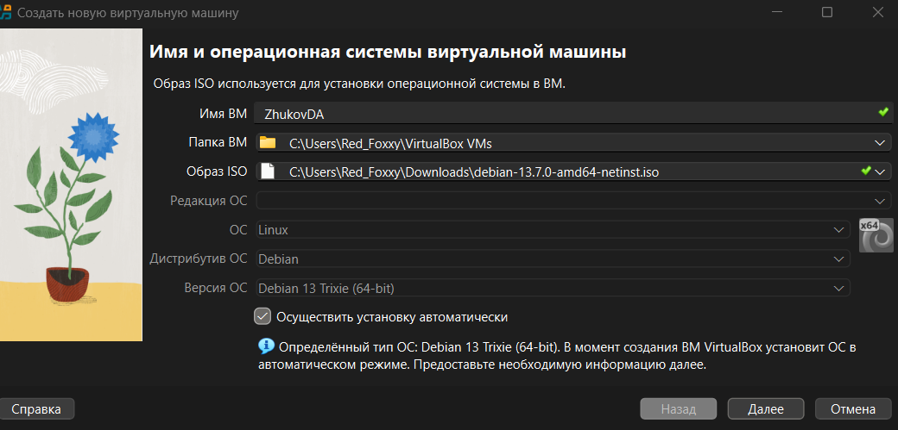

*Рис. 1.1 — Указание имени виртуальной машины и подключение ISO-образа Debian 13*

3. Для виртуальной машины выделено **4096 МБ (4 ГБ)** оперативной памяти, **2 вычислительных ядра ЦПУ** и создан виртуальный жесткий диск объемом **30,00 ГБ**.

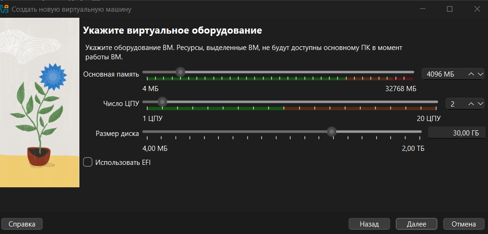

*Рис. 1.2 — Настройка объема оперативной памяти (4 ГБ), числа ЦПУ (2) и размера диска (30 ГБ)*

---

### 2. Установка Debian и настройка основных параметров

1. На этапе предварительной конфигурации и установки гостевой ОС заданы учетные данные пользователя (`zhukov.d.a`), пароль, имя хоста (`zhukovbox`) и домен `myguest.virtualbox.org`.

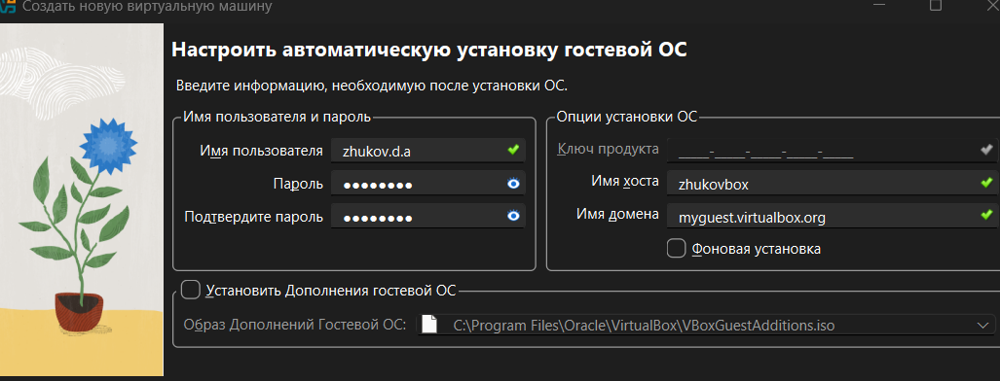

*Рис. 2.1 — Настройка параметров пользователя, пароля и имени хоста*

2. Проверена итоговая сводка параметров виртуальной машины перед запуском процесса установки ОС.

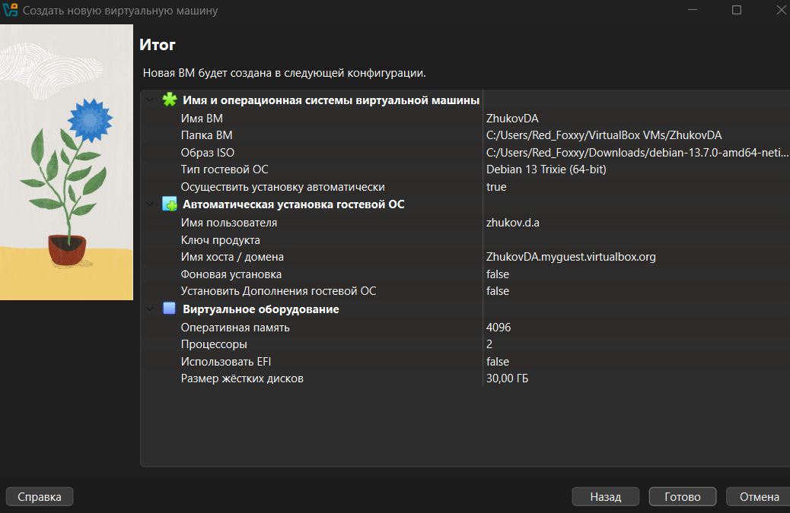

*Рис. 2.2 — Итоговая конфигурация виртуальной машины ZhukovDA*

3. После завершения установки Debian 13 настроена локализация, часовой пояс и создана рабочая учетная запись пользователя `user1` с правами администратора (`sudo`).

---

### 3. Настройка сети (NAT и Bridged) и обновление системы

#### 3.1. Настройка подключения через NAT и Bridged

Для работы виртуальной машины одновременно с внешней сетью Интернет и локальной сетью хост-компьютера задействованы два сетевых интерфейса:

* **enp0s3 (Адаптер 1 — NAT):** используется для выхода виртуальной машины в Интернет (получен IP-адрес `10.0.2.15/24`).

* **enp0s8 (Адаптер 2 — Сетевой мост / Bridged):** используется для прямой видимости виртуальной машины в локальной сети хоста (`192.168.0.x`).

Проверена конфигурация сетевых интерфейсов командой `ip a`:

~~~bash

ip a

~~~

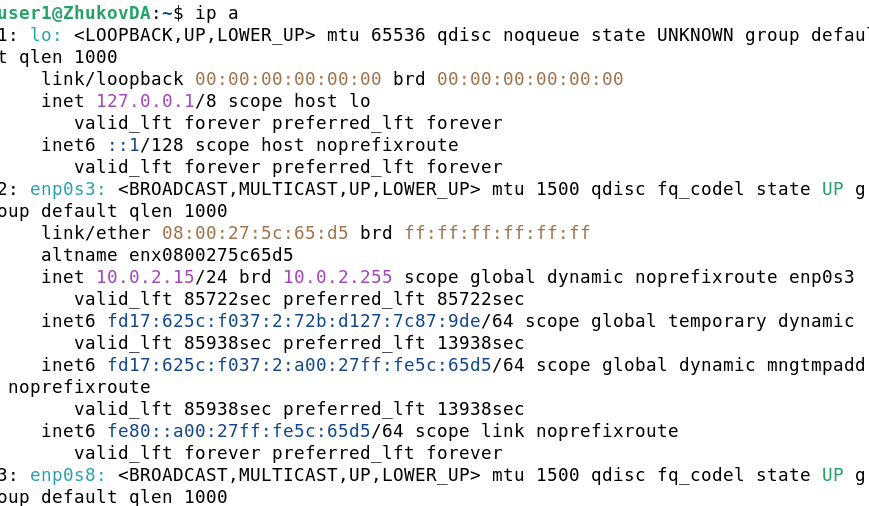

*Рис. 3.1 — Сетевые интерфейсы `enp0s3` (NAT) и `enp0s8` (Bridged)*

Проверена доступность сети Интернет с помощью утилиты `ping` до DNS-сервера Google (`8.8.8.8`):

~~~bash

ping -c 4 8.8.8.8

~~~

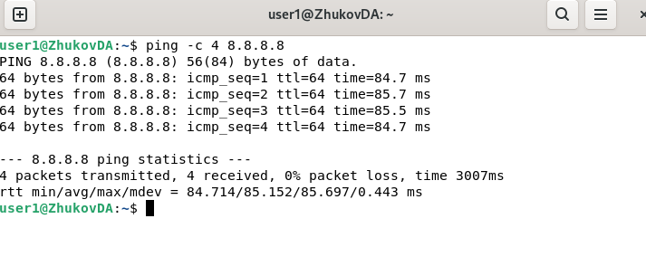

*Рис. 3.2 — Успешный обмен ICMP-пакетами с узлом 8.8.8.8 (0% потерь)*

Для автоматического получения IP-адреса по DHCP на втором интерфейсе (`enp0s8` — Сетевой мост) установлен пакет `isc-dhcp-client` и запрошен адрес у локального маршрутизатора:

~~~bash

sudo apt-get install isc-dhcp-client -y

sudo dhclient enp0s8

ip a

~~~

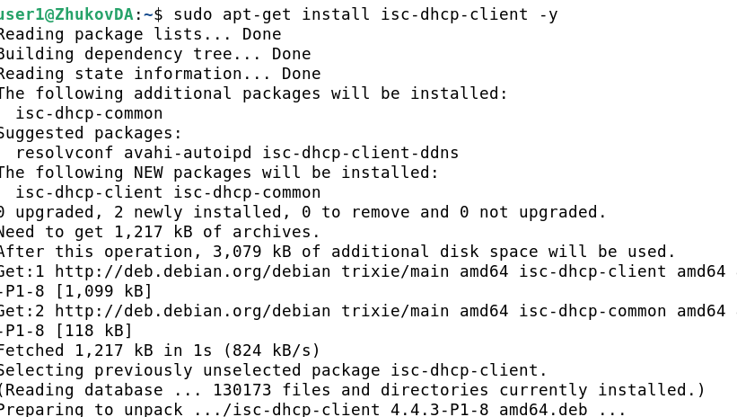

*Рис. 3.3 — Установка DHCP-клиента `isc-dhcp-client`*

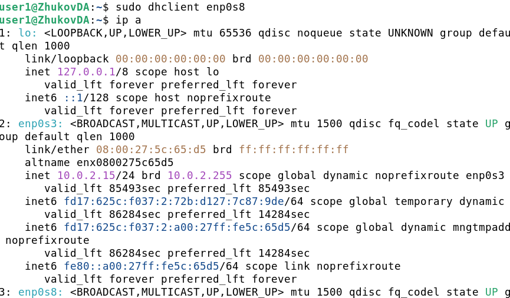

*Рис. 3.4 — Запрос сетевых параметров для интерфейса `enp0s8` (`sudo dhclient enp0s8`)*

В результате сетевой мост `enp0s8` получил локальный IP-адрес **`192.168.0.103`**.

#### 3.2. Обновление системы

Выполнена синхронизация индексов репозиториев (`apt-get update`) и обновление установленных в системе пакетов (`apt-get upgrade`):

~~~bash

sudo apt-get update

sudo apt-get upgrade -y

~~~

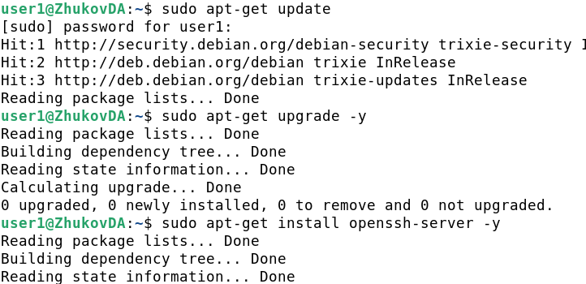

*Рис. 3.5 — Выполнение команд `sudo apt-get update` и `sudo apt-get upgrade -y`*

---

### 4. Настройка SSH-сервера и удаленного доступа

#### 4.1. Установка и запуск SSH-сервера

На виртуальной машине установлен пакет `openssh-server`:

~~~bash

sudo apt-get install openssh-server -y

~~~

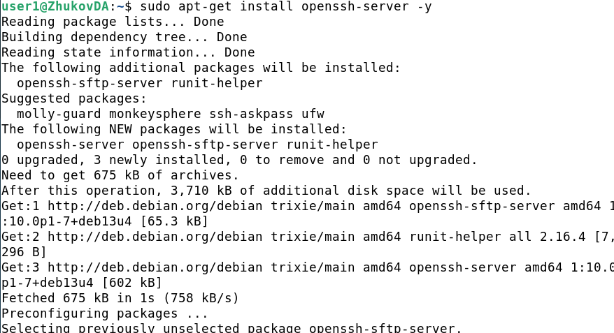

*Рис. 4.1 — Установка `openssh-server` из репозитория Debian Trixie*

Проверено состояние службы `ssh` через `systemd`:

~~~bash

sudo systemctl status ssh

~~~

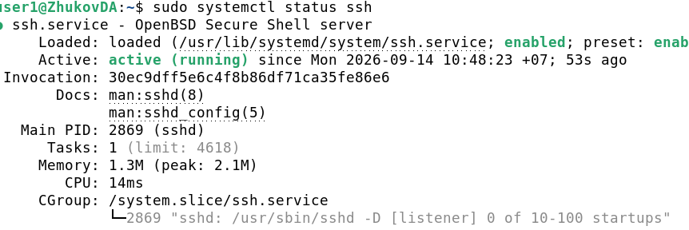

*Рис. 4.2 — Служба `ssh.service` активна и запущена (`active (running)`)*

#### 4.2. Доступ по SSH с основного компьютера по паролю

С хост-машины под управлением ОС Windows (через **Windows PowerShell**) выполнено подключение к виртуальной машине по IP-адресу сетевого моста (`192.168.0.103`) под пользователем `user1`:

~~~powershell

ssh user1@192.168.0.103

~~~

При первом подключении подтвержден криптографический отпечаток сервера (`ED25519 key fingerprint`) и введен пароль пользователя `user1`.

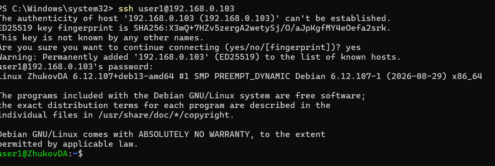

*Рис. 4.3 — Успешная авторизация по SSH с хост-машины по паролю*

#### 4.3. Доступ по SSH по криптографическому ключу

Для настройки беспарольной аутентификации по открытому ключу (`id_rsa.pub`) с основного компьютера выполнена передача публичного ключа в файл `~/.ssh/authorized_keys` на виртуальной машине через PowerShell:

~~~powershell

Get-Content "$env:USERPROFILE\.ssh\id_rsa.pub" | ssh user1@192.168.0.103 "mkdir -p ~/.ssh && cat >> ~/.ssh/authorized_keys"

~~~

После добавления ключа выполнено повторное подключение к серверу:

~~~powershell

ssh user1@192.168.0.103

~~~

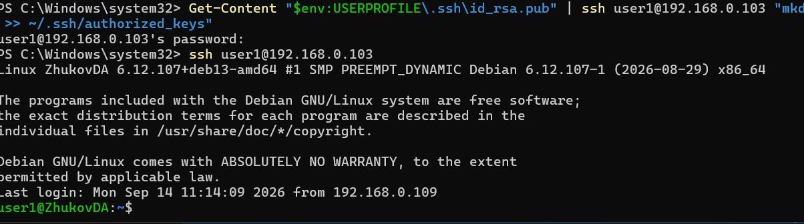

*Рис. 4.4 — Передача открытого ключа `id_rsa.pub` на ВМ и успешный вход по SSH без запроса пароля*

---

## Вывод

В рамках лабораторной работы развернута виртуальная машина в среде VirtualBox и установлена ОС Debian 13 (Trixie). Настроена работа двух сетевых интерфейсов в режимах NAT (`10.0.2.15`) и Bridged (`192.168.0.103`), проведено обновление системы с помощью пакетного менеджера `apt-get`, установлен и запущен демон `openssh-server`, а также настроен удаленный доступ с хост-машины по протоколу SSH как по паролю, так и по ключевой паре RSA.